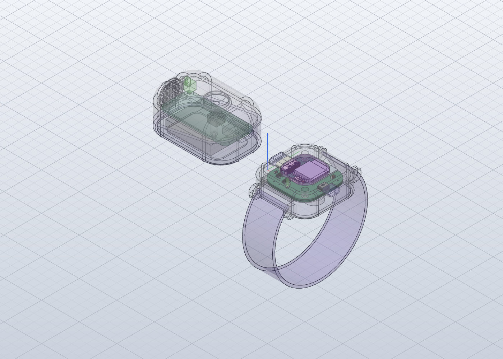

# Fit check: bmm-receiver in the enclosure

Real board (KiCad STEP export, parts included) placed in `4-model/model.solidcraft` where `fit.json` puts it, with Stage 4's stand-ins removed (R PCB, R USB-C, R Side Switch, R Glow LED, R Link LED). Re-run with `python3 tools/fit/fitcheck.py episodes/003-003/5-electronics/receiver`.

**Result: PASS**: 0 overlaps, 6 gaps under 0.3 mm, 0 pairs the checker couldn't measure.

Board placed at enclosure x 10.0..40.0, y -15.0..15.0, z 6.6..8.1.

## Close (under 0.3 mm)

- Watch Case to bmm-receiver_PCB: 0.02 mm (posts: the board rests on them, lifted 0.02 mm for the check)
- Awake Button to bmm-receiver_PCB: 0.10 mm
- Awake Button to Panasonic_EVQPUJ_EVQPUA: 0.10 mm
- Watch Lens to USB_C_Receptacle_16P_TopMnt_Horizontal_GCT_USB4105-xx-A (18): 0.22 mm
- Watch Lens to USB_C_Receptacle_16P_TopMnt_Horizontal_GCT_USB4105-xx-A (36): 0.22 mm
- Link Pipe to LED_0603_1608Metric: 0.23 mm

