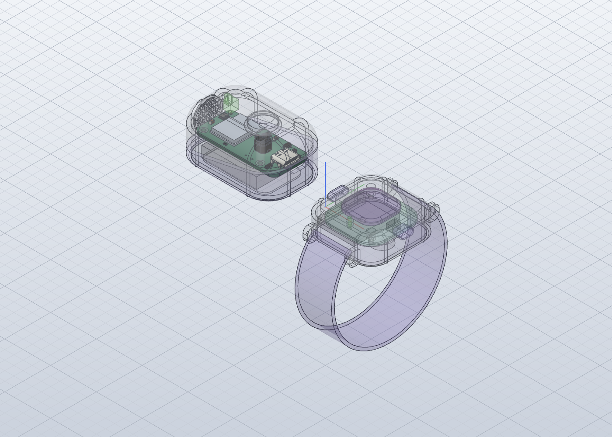

# Fit check: bmm-sensor in the enclosure

Real board (KiCad STEP export, parts included) placed in `4-model/model.solidcraft` where `fit.json` puts it, with Stage 4's stand-ins removed (S PCB, S Mic, S Status LED, S Tact Switch, S USB-C). Re-run with `python3 tools/fit/fitcheck.py episodes/003-003/5-electronics/sensor`.

**Result: FAIL**: 1 overlaps, 3 gaps under 0.3 mm, 0 pairs the checker couldn't measure.

Board placed at enclosure x -62.0..-18.0, y -10.0..10.0, z 9.0..10.5.

## Overlaps

- **LinkGroup** into **Sensor Button**: 3.74 mm³ at board (6.0, -0.0), +4.8 mm from the top face; enclosure (-34.0, -0.0, 15.3)

## Close (under 0.3 mm)

- Sensor Upper to bmm-sensor_PCB: 0.02 mm (posts: the board rests on them, lifted 0.02 mm for the check)
- S Battery to C_0603_1608Metric: 0.18 mm
- Sensor Light Pipe to LED_0603_1608Metric: 0.23 mm

