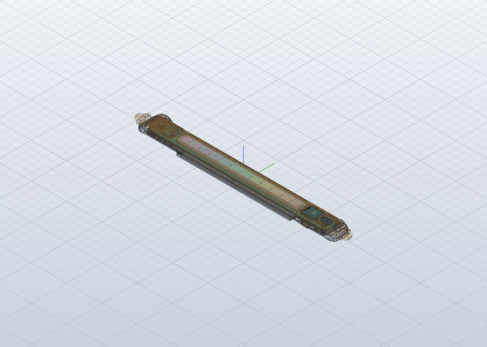

# Fit check: aqua-accent in the enclosure

Real board (KiCad STEP export, parts included) placed in `4-model/model.solidcraft` where `fit.json` puts it, with Stage 4's stand-ins removed (PCB, XIAO, XIAO USB-C, APDS-9960, APDS-9251, Button SW, LED 1, LED 2, LED 3, LED 4, LED 5, LED 6, LED 7, LED 8, LED 9, LED 10, LED 11, LED 12). Re-run with `python3 tools/fit/fitcheck.py episodes/004-004`.

**Result: PASS**: 0 overlaps, 6 gaps under 0.3 mm, 0 pairs the checker couldn't measure.

Board placed at enclosure x -124.0..124.0, y -10.7..10.7, z 5.7..6.6.

## Close (under 0.3 mm)

- Deck to aqua-accent_PCB: 0.03 mm
- Port Cap to SW_SPST_PTS810: 0.09 mm
- Deck to Seeed_XIAO_ESP32C6: 0.10 mm
- Base to aqua-accent_PCB: 0.11 mm
- USB Plug to Seeed_XIAO_ESP32C6: 0.15 mm
- Deck to APDS-9960: 0.20 mm

