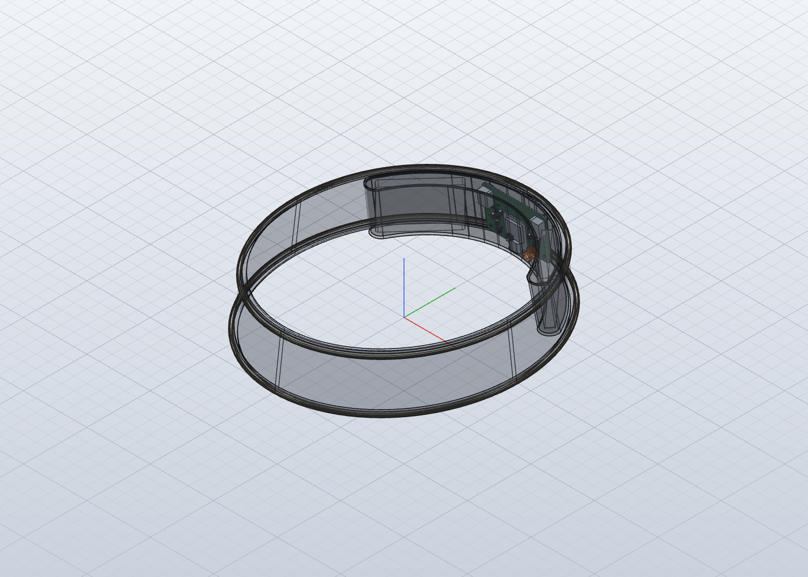

# Fit check: bucket-hat in the enclosure

Real board (KiCad STEP export, parts included) placed in `4-model/fit_model.solidcraft` where `fit.json` puts it, with Stage 4's stand-ins removed (PCB, XIAO, XIAO USB-C, Plug A, Plug B, Button SW). Re-run with `python3 tools/fit/fitcheck.py episodes/005-005`.

**Result: PASS**: 0 overlaps, 4 gaps under 0.3 mm, 0 pairs the checker couldn't measure.

Board placed at enclosure x -25.0..25.0, y 86.3..91.3, z 3.5..37.3.

## Close (under 0.3 mm)

- Mode Key to SW_SPST_PTS810: 0.09 mm
- Pod to bucket-hat_PCB: 0.11 mm
- Pod to Seeed_XIAO_nRF52840: 0.26 mm
- Pod Lid to bucket-hat_PCB: 0.27 mm

