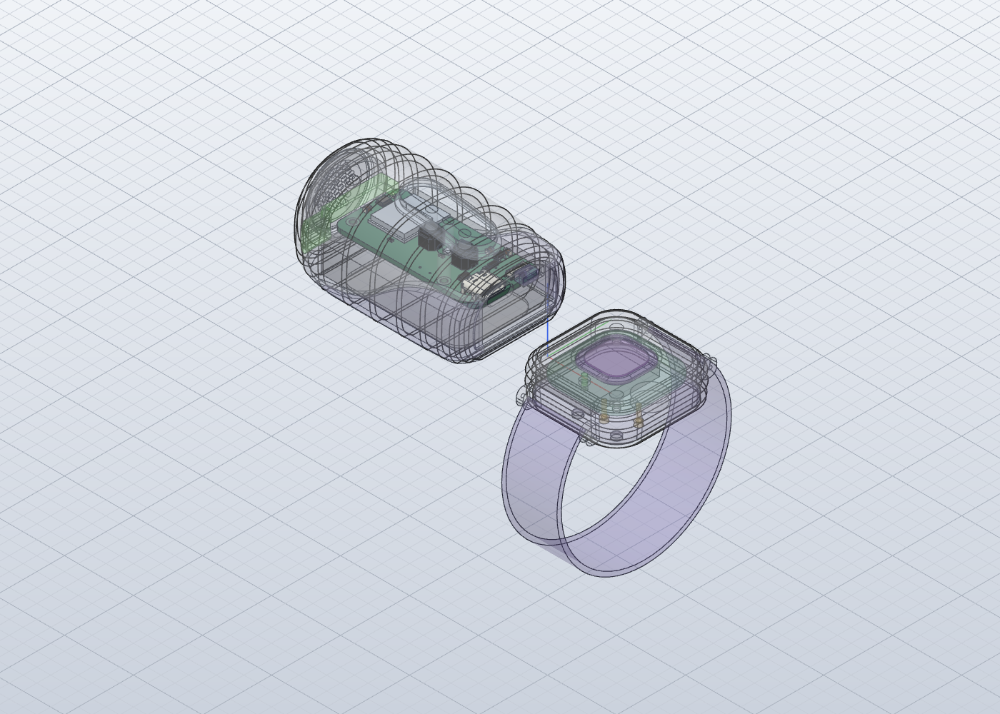

# Fit check: bmm-sensor in the enclosure

Real board (KiCad STEP export, parts included) placed in `4-model/model.solidcraft` where `fit.json` puts it, with Stage 4's stand-ins removed (S PCB, S Mic, S Status LED, S Tact Switch, S Tact Switch 2, S USB-C, S Power Switch, S Switch Lever, S Bar LED). Re-run with `python3 tools/fit/fitcheck.py products/baby-monitor-monitor/rev-b/5-electronics/sensor`.

**Result: PASS**: 0 overlaps, 5 gaps under 0.3 mm, 0 pairs the checker couldn't measure.

Board placed at enclosure x -66.0..-14.0, y -12.0..12.0, z 13.0..14.5.

## Close (under 0.3 mm)

- Sensor Upper to bmm-sensor_PCB: 0.02 mm (posts: the board rests on them, lifted 0.02 mm for the check)
- Switch Slider to Fusion_sp: 0.03 mm
- Switch Slider to bmm-sensor_PCB: 0.17 mm
- Snooze Bar to LinkGroup: 0.23 mm
- Sensor Light Pipe to LED_0603_1608Metric: 0.23 mm

