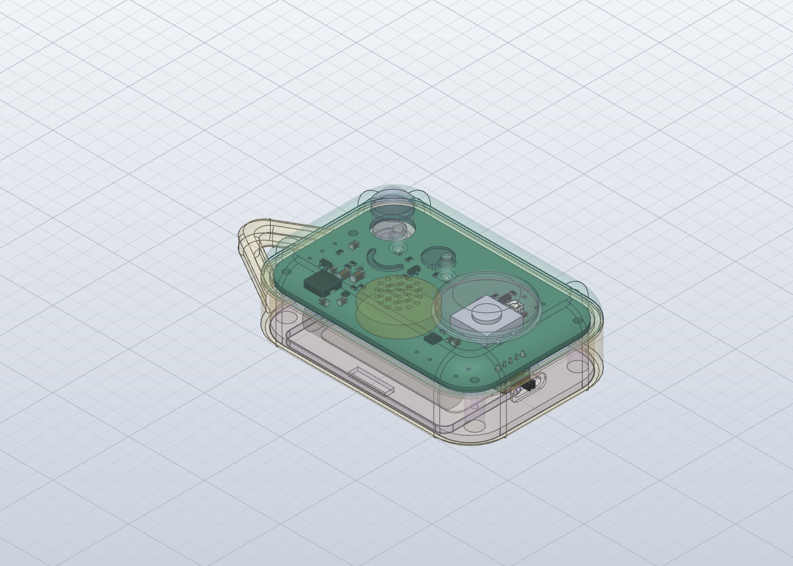

# Fit check: backpack-defender in the enclosure

Real board (KiCad STEP export, parts included) placed in `4-model/model.solidcraft` where `fit.json` puts it, with Stage 4's stand-ins removed (PCB, ESP32-C3-WROOM-02, Tact Switch, Switch Plunger, MAX98357A, Eye LED L, Eye LED R, Power Switch, Power Switch Lever, Button LED). Re-run with `python3 tools/fit/fitcheck.py episodes/rev-b`.

**Result: PASS**: 0 overlaps, 5 gaps under 0.3 mm, 0 pairs the checker couldn't measure.

Board placed at enclosure x -35.0..35.0, y -22.5..22.5, z 13.6..15.1.

## Close (under 0.3 mm)

- Bottom Plate to backpack-defender_PCB: 0.11 mm
- Eye Light R to LED_0603_1608Metric: 0.20 mm
- Silence Button to SW_PUSH-12mm_H4.3: 0.20 mm
- Base to SW_Slide_SPDT_Angled_CK_OS102011MA1Q (3): 0.27 mm
- Speaker to backpack-defender_PCB: 0.28 mm

